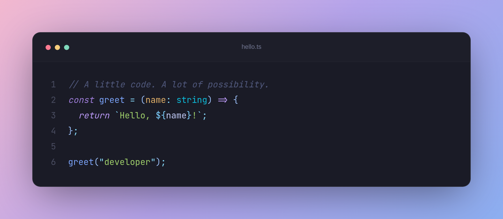
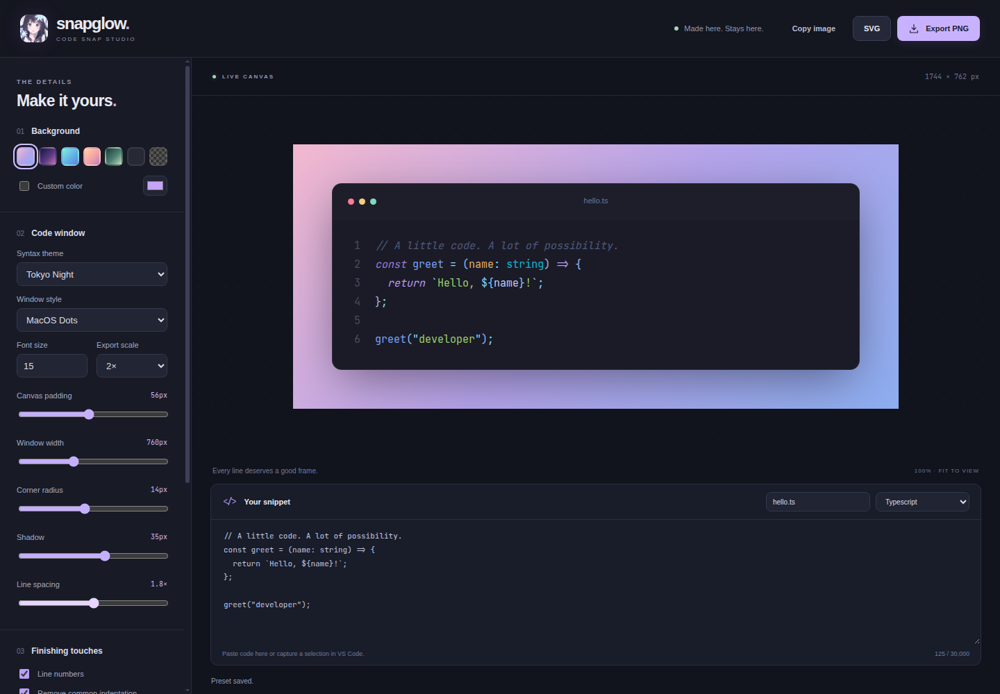

<p align="center">
  
</p>

<h1 align="center">Snapglow · Code Snap Studio</h1>

<p align="center">A beautiful frame for your code.<br>Capture, customize, and export code screenshots directly from VS Code. Entirely offline.</p>

<p align="center">
  <a href="https://github.com/kirasync2748/snapglow-studio/actions/workflows/ci.yml"></a>
  <a href="https://github.com/kirasync2748/snapglow-studio/actions/workflows/publish.yml"></a>
  <a href="https://marketplace.visualstudio.com/items?itemName=kirasync2748.snapglow-studio"></a>
  <a href="https://marketplace.visualstudio.com/items?itemName=kirasync2748.snapglow-studio"></a>
</p>



## A studio inside your editor

Select your code, open Snapglow, and give it a frame worth sharing. Fonts, syntax grammars, and themes ship with the extension. Your code stays on your machine.

| Create                                    | Customize                                      | Share                                 |
| ----------------------------------------- | ---------------------------------------------- | ------------------------------------- |
| Capture a selection or entire file        | Seven syntax themes and six backgrounds        | PNG at 1×, 2×, 3×, or 4×              |
| Edit the captured snapshot                | Custom colors or transparent canvas            | Browser-compatible SVG                |
| Choose from 242 bundled language grammars | Window styles, shadows, padding, and corners   | PNG clipboard copying where supported |
| Save up to 12 appearance presets          | Line numbers, line highlights, and indentation | Save directly through VS Code         |

## Get started

1. Select a code snippet in VS Code.
2. Right-click and choose **Snapglow: Capture Selection**. Shortcut: **Ctrl+Alt+S**, or **Cmd+Alt+S** on macOS.
3. Adjust the appearance and click **Export PNG**, **SVG**, or **Copy image**.

Use **Snapglow: Open Studio** from the Command Palette to start with an example. Capture Selection uses the entire active file when no text is selected. Captures are snapshots; subsequent edits to the file do not alter the captured code.

### Install

Download a `.vsix` from [GitHub Releases](https://github.com/kirasync2748/snapglow-studio/releases), then run **Extensions: Install from VSIX** in VS Code / search for **Snapglow: Code Snap Studio** by **kirasync2748** or install `kirasync2748.snapglow-studio`.

## Language support

**All 242 grammars in the bundled Shiki catalog** are available offline, including their aliases. This includes C, C++, C#, Java, Kotlin, Swift, PHP, Ruby, Python, Go, Rust, Dart, Lua, R, Julia, SQL, PowerShell, Shell, Docker, Haskell, Elixir, Erlang, F#, OCaml, Solidity, Vue, Svelte, Astro, and many more.

The studio loads the selected grammar when needed and uses the Oniguruma engine for TextMate compatibility. VS Code language identifiers such as `shellscript`, `typescriptreact`, and `javascriptreact` resolve automatically. The language selector lets you override a detected language.

No highlighter can guarantee syntax grammars for every custom or future language. Language IDs outside this bundled catalog display their code safely as text; select a related grammar when appropriate. The catalog completeness test checks every bundled grammar and alias so updates cannot silently omit languages.

## Make it yours

- **Canvas:** background presets, custom hex color, transparency, padding, and width.
- **Window:** macOS dots, minimal title bar, or no header; adjustable corners and shadow.
- **Code:** theme, font size, line spacing, line numbers, indentation trimming, and highlights like `2, 4-6`.
- **Presets:** save, replace, load, and delete up to 12 named looks across studio sessions.
- **Source numbering:** enable `snapglow.keepOriginalLineNumbers` to retain source line numbers, or set the first line manually.



## Privacy and compatibility

No accounts, telemetry, remote fonts, or code uploads. Source lives in the open studio panel and is discarded when the panel closes. Appearance presets are stored locally in VS Code extension storage and include their window title. See [Privacy](PRIVACY.md).

Requires **VS Code 1.146 or newer**. Node is not required to use the installed extension. Development uses **Node 26.13.1 LTS**; the host bundle targets VS Code's embedded runtime.

- Maximum snippet: 30,000 characters.
- Export limits: 40 million pixels, 16,000 pixels per edge, approximately 20 MB.
- Line highlights apply to relative line numbers across the entire snippet.
- SVG uses embedded XHTML (`foreignObject`); use PNG for design tools that do not support it.
- Image clipboard availability depends on platform permissions. PNG file export works independently.

## Develop and test

```sh
# Select Node 26.13.1 using .nvmrc or mise.toml
npm ci
npm run build
npm run check
npm test
npm run test:extension # Linux: xvfb-run -a npm run test:extension
npx playwright install --with-deps chromium
npm run test:e2e
npm run package
```

Press **F5** to launch an Extension Development Host. For the standalone browser preview, run `npm run build` and `npm run preview`, then visit `http://localhost:4173`. Preview exports download through the browser; settings persistence is provided by the extension host.

`npm run check` runs strict TypeScript checks, Biome lint with warnings treated as failures, and Prettier. `npm run format` applies formatting. Unit tests cover validation and release guards; the grammar test compiles and tokenizes the complete catalog. Browser tests exercise styling, presets, safe source rendering, exports, and the extension message bridge. Extension-host tests activate the real extension and execute its capture commands.

## Contribute

[Report an issue](https://github.com/kirasync2748/snapglow-studio/issues) · [Contributing](CONTRIBUTING.md) · [Security](SECURITY.md) · [Releases](https://github.com/kirasync2748/snapglow-studio/releases)

MIT licensed source. JetBrains Mono is bundled under the SIL Open Font License. Dependency license notices are retained in the compiled bundles. The anime icon is cropped from the image supplied by the project maintainer.
